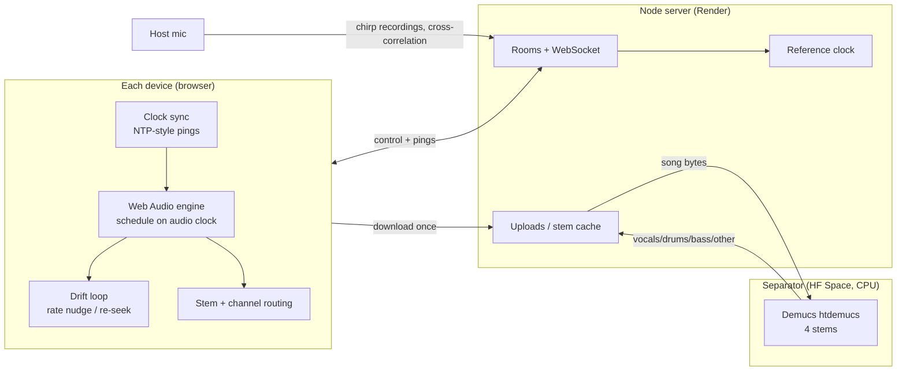

# SyncWave

**Turn every phone and laptop in a room into one synced speaker system, in the browser, with AI that gives each device its own part of the song and measures and fixes each device's real audio delay.**

## Live links

| What | Link | Status |
| --- | --- | --- |
| Web app (Render, free tier) | _not deployed yet_ | pending, see [docs/deploy.md](docs/deploy.md) |
| Stem separation service (Hugging Face Space, Demucs) | _not deployed yet_ | pending, see [docs/deploy.md](docs/deploy.md) |
| Source | `github.com/agentsc07/syncwave` (private) | local commits only, not pushed yet |
| One-page report | [docs/report.md](docs/report.md) | done |
| 2-minute demo script | [docs/demo-script.md](docs/demo-script.md) | done |
| Real-device evaluation protocol | [docs/eval-protocol.md](docs/eval-protocol.md) | done, not yet run on hardware |

This table is the single place to update when the deploys are live.

## The problem

One phone speaker cannot fill a room, Bluetooth speakers play one at a time, and multi-room systems (Sonos, Chromecast groups) need matching hardware. A room of people already carries five to twenty speakers. Playing the same sound on all of them is hard because two speakers more than about 20–30 ms apart sound like an echo, and every phone has a different, unknown output delay (Bluetooth speakers add 100 ms or more).

## What it does

- **Zero install.** Open a link or scan a QR code; any modern browser becomes a speaker. Room code, join under 10 s, installable as a PWA.
- **Synced playback.** Every device starts the same pre-loaded audio at the same instant and corrects drift while it plays.
- **AI feature A: Orchestra mode.** Demucs (htdemucs) splits a song into vocals / drums / bass / other. Each phone plays a different stem, assigned by where it sits in the room, all in sync. "Everyone plays everything" is the fallback.
- **AI/data feature B: acoustic auto-calibration.** Each device plays a chirp in turn; the host's microphone records; cross-correlation measures each device's real acoustic delay and sets its trim automatically. Each device gets a 0–100 sync score. This replaces dragging a trim slider for a Bluetooth speaker.
- Also: sync radar (live offset per device), spatial mode (left/right/centre channels), beat light show, live tab-audio share, mic announce, guest queue with voting, host handoff, late join at the exact current position.

## How it works



1. **Clock.** A device sends a ping stamped t0; the server stamps t1 and t2; the device stamps t3. Offset = ((t1−t0)+(t2−t3))/2. It sends 20 pings, keeps the lowest-RTT 30 % (least Wi-Fi jitter) and takes the median, then repeats every 3 s.
2. **Shared timeline.** The room stores one number: the song started at server time S. Position = server now − S, so play, pause, seek and late join all follow from it.
3. **Precise start.** Each device decodes the whole file (or its stems) first, then schedules playback on the **audio clock** at S converted to local time, minus the browser-reported output latency.
4. **Drift.** Every 2 s each device compares expected and actual position: under 40 ms it nudges playback rate by at most 0.5 %; over 40 ms it re-seeks.
5. **Orchestra (A).** The server sends the song to the Demucs service, caches the four stems by SHA-256, and assigns stems to devices by room position. Stems start at the same scheduled instant through one shared anchor, so drift correction moves them together.
6. **Auto-calibration (B).** The server runs one device at a time: 3 log-sweep chirps (2–8 kHz, 100 ms). The host mic records; a normalised cross-correlation finds each arrival to sub-sample precision, taking the earliest strong peak so a louder room echo does not win. Trim is set so all devices align to the host device. Score = repeat-to-repeat jitter and peak-to-sidelobe confidence.

Full design: [spec.md](spec.md). Wire contract: [PROTOCOL.md](PROTOCOL.md).

## Results

**Spec targets:** five mixed devices, median offset < 10 ms, worst < 20 ms, held for 10 minutes.

| Measurement | Simulated (this repo, reproducible) | Real devices |
| --- | --- | --- |
| Start offset, median | **1.10 ms** (5 devices, 600 s, 10 ms jitter) | _pending: needs your hardware_ |
| Start offset, worst | **10.87 ms** (same run; target < 20) | _pending_ |
| Offset in the last 60 s (drift) | median 0.97 ms, worst 4.36 ms | _pending_ |
| Before → after auto-calibration | not simulated | _pending_ |
| Bluetooth device before → after | not simulated | _pending_ |
| Late join landing error | not simulated | _pending_ |
| Join time from QR | not simulated | _pending_ |

How the numbers were produced and what they mean:

- **Simulated** numbers come from `npm run sim -- --devices 5 --duration 600 --jitter 10` against the real server over real WebSockets, with injected latency, jitter, clock skew and ppm drift per device. They validate the clock estimator, scheduling maths and drift loop. **They do not include real browser or OS audio-output latency**, so they say nothing about how a real Bluetooth speaker or iPhone behaves. A 20-device stress run (`--devices 20 --jitter 15 --latency-max 60`) also passed in an earlier run.
- **Calibration accuracy** is tested only on synthetic recordings: a device delayed by 187.3 ms and another at −4.2 ms (with a 90 %-loud echo and an overlapping second chirp) are recovered within 0.5 ms (`server/test/calibrate.test.js`). Real rooms are untested.
- **Real-device numbers** need 4–5 devices and one recorder. The exact protocol and the analysis script are ready: [docs/eval-protocol.md](docs/eval-protocol.md), `eval/analyze.py` (5 synthetic-recording tests pass). Once you have recordings: `python eval/analyze.py --compare before.wav after.wav --sim-json sim.json` prints this table side by side; create `sim.json` with `npm run sim -- --json sim.json`.
- 9 server test files pass (`cd server && for t in test/*.test.js; do node --test $t; done`), plus pytest suites for `separator/` (9) and `eval/` (5).

## Known limitations

- Nothing has been run in a real browser or on a phone yet; the UI, PWA, service worker, audio capture and calibration are covered by builds, Node tests with fake audio contexts, and curl only.
- iPhone silent mode cannot be detected by web APIs; the app shows a hint.
- Uploads are temporary on the free Render tier (disk is ephemeral; the UI says so). Free Hugging Face Spaces sleep when idle, and CPU separation of a 4-minute song may take 5–10 minutes, so demo songs are pre-separated.
- No streaming from Spotify/YouTube (terms and DRM); users play their own files.
- If the host device itself has a large output delay (e.g. Bluetooth), calibration aligns everyone to the host.
- Each Orchestra device downloads the full mix plus its stems (~4 MB per stem); removing a stem mid-play is a hard stop and may click.

## Run it

Requires Node 20+. Short version in [startup.md](startup.md).

```
npm install
npm run build        # builds client into client/dist
npm start            # http://localhost:3000 (PORT=3001 npm start to change)
```

Open on phones with the laptop's LAN IP (`http://<ip>:3000`), same Wi-Fi or a phone hotspot (works with no internet). The microphone (auto-calibration, announce) and tab capture need **HTTPS or localhost**; a deployed Render URL has HTTPS automatically, and for a LAN demo see the `mkcert` recipe in [Live share and Announce](#live-share-and-announce).

Orchestra mode needs the separator: `SEPARATOR_URL=https://<space>.hf.space SEPARATOR_TOKEN=<secret> npm start` (details under [Orchestra mode](#orchestra-mode)). Without it the rest of the app works and the Demo library is available. Deploy steps: [docs/deploy.md](docs/deploy.md).

Tests and simulator:

```
cd server && for t in test/*.test.js; do node --test $t; done
npm run sim -- --devices 5 --duration 600 --jitter 10 --json sim.json
```

Repository map: `server/` (rooms, clock, uploads, separator client, calibration state machine), `client/` (React + Web Audio engine), `separator/` (Demucs FastAPI service for a Hugging Face Docker Space), `sim/` (fake-latency device simulator), `eval/` (recording analysis), `docs/`.

---

## Reference

### Open it on phones (LAN)

1. Put the laptop and phones on the same Wi-Fi.
2. Find the laptop's LAN IP (macOS: `ipconfig getifaddr en0`; Linux: `hostname -I`; Windows: `ipconfig`).
3. On the host device open `http://<LAN-IP>:3000`, create a room, and upload a track.
4. Guests open the same URL (or scan the room QR code), tap join, then "Tap to start" to unlock audio.
5. When every device shows ready, the host presses play.

iPhones may mute web audio in silent mode (flip the switch off). Keep screens on (Wake Lock is requested).

### Live share and Announce

Host-only, in the Play tab. **Share tab/system audio** (desktop Chrome/Edge) captures a tab or the system via `getDisplayMedia` (the video is discarded; choose a tab and tick "Share tab audio"), and **Announce (mic)** captures the microphone (works on phones too). Audio is sent in ~20 ms chunks through the server, each stamped with server time, and every device (including the host) plays it `delay` later: 1.5 s by default for share (slider 0.8–3 s, which also absorbs Wi-Fi jitter) and about 0.25 s for announce. While announcing, the music is ducked to 25 % on every device. Starting a share stops file playback. Share sends about 1.5 Mbit/s per receiver.

`getUserMedia` / `getDisplayMedia` only work on secure origins. `http://localhost:3000` is fine; **phones opening `http://<LAN-IP>:3000` cannot use the mic or tab capture** (they can still listen). To use the host controls from a phone on a LAN, serve over HTTPS:

```
brew install mkcert && mkcert -install            # one-time (other OSes: see mkcert docs)
mkcert -key-file key.pem -cert-file cert.pem localhost <LAN-IP>
SSL_KEY=key.pem SSL_CERT=cert.pem npm start       # https://<LAN-IP>:3000, wss for the socket
```

Other devices must trust the mkcert root CA. Tip: Chrome mutes the shared tab locally, so you only hear the delayed copy; if you share system audio, mute the source app instead.

### Hotspot mode (no internet)

Turn on a phone hotspot (or travel router), join the laptop and all other devices to it, run `npm start` on the laptop and use its IP on that network. Nothing needs the internet: the client is served by the server and audio is downloaded from it once.

### Auto-calibration

Host: Devices tab → **Auto-calibrate** (pause music, keep the room quiet, needs HTTPS or localhost for the mic). Each device plays a 2–8 kHz chirp three times in turn while the host's mic records; cross-correlation measures each device's real acoustic delay and sets every trim so all devices line up with the host's device (positive trim = play earlier). Each device gets a 0–100 sync score (green/amber/red) in the device list and on the radar; manual trim sliders stay as an override. Sound travel time (~3 ms per metre) is part of the measurement, so place the host device where you want the best sound. A noisy room or quiet speaker gives "low confidence" and leaves that device's trim unchanged.

### Orchestra mode

1. **Stem source.** *Separate this song into stems* (Orchestra tab, host) sends the track to the Demucs service in `separator/`, or pick a song from the **Demo library** (pre-separated, instant; see `server/demo/README.md` and `docs/deploy.md` section C).
2. **Configure the separator** on the SyncWave server with `SEPARATOR_URL` and `SEPARATOR_TOKEN`. Unset means separation is disabled (the UI says so). Results are cached by the track's SHA-256.
3. **Turn Orchestra on.** *Auto-assign* follows the room map left to right (vocals, drums, bass, other; 3 devices: vocals+other / drums / bass; 2 devices: vocals+other vs drums+bass; more devices than stems share round-robin) and reassigns on join, leave or move. Tap stem chips to assign by hand; four sliders mix the stems.
4. **Fallback.** Orchestra off, or stems not ready: everyone plays the full mix. Play is allowed only once every device has decoded its assigned stems.

### Test matrix (real devices)

| Area | Check | Pass |
| --- | --- | --- |
| Start sync | 5 mixed devices, one external mic, onset gaps | median < 10 ms, worst < 20 ms |
| Drift | same recording at minute 10, plus sync radar | < 10 ms |
| Late join | join mid-song, external recording | lands within 15 ms |
| Calibration | Bluetooth phone before vs after auto-calibrate | gap shrinks to < 10 ms |
| Join | QR scan to playing, 5 trials | under 10 s |
| Browsers | Chrome Android, Safari iOS, Chrome and Firefox desktop | join, play, pause, seek, next |
| Spatial | assign left/right/centre | separate channels audible |
| Orchestra | 4 phones, vocals and drums on different phones | each phone plays only its stem, in sync |
| Hotspot | phone hotspot, no internet | all of the above still work |
